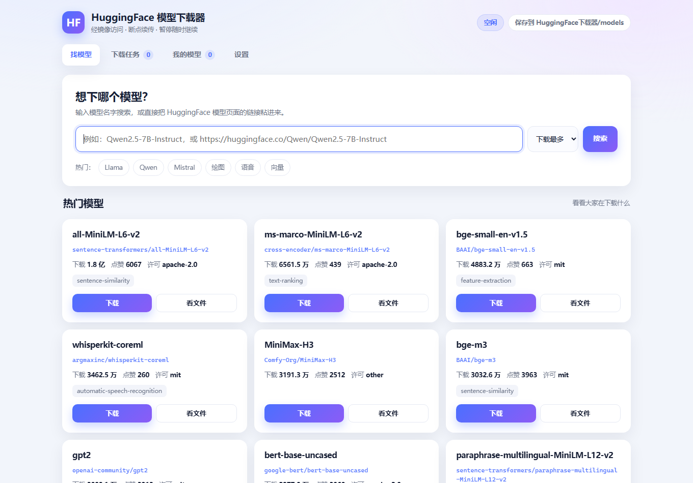

# HuggingFace Model Downloader

[](https://github.com/15072400099/huggingface-downloader/actions/workflows/ci.yml)

A **double-click download manager for [HuggingFace](https://huggingface.co) models**, made for people who don't write code.

Since `huggingface.co` is usually unreachable from mainland China, it defaults to the
**hf-mirror.com** mirror. Search, file listing, downloads and resume all happen in one local web UI.



> Chinese is the primary language of this project; this file is the English mirror.

## Highlights

- **Zero third-party dependencies** — Python standard library only; HTTP goes through the
  `curl.exe` that ships with Windows. No `pip install` needed.
- **Resumable** — pause, close the app, lose the network: the next run continues from the byte it stopped at.
- **Configurable mirror and proxy** — with a one-click "test connection" button.
- **Readable** — live speed, ETA, downloaded/total, and per-file selection.

## Quick start

### Option A — prebuilt exe

Download `HFModelDownloader.exe` from [Releases](../../releases), put it in a folder, double-click it.
Models are saved to `models\` next to the exe.

### Option B — from source (Windows, Python 3.10+)

```bat
启动下载器.bat
```

No dependencies to install. The browser opens <http://127.0.0.1:8766>.

### The batch files

| File | Purpose |
|---|---|
| `启动下载器.bat` | Start (double-clicking twice won't start a second copy) |
| `关闭下载器.bat` | Stop the service and clean leftover windows |
| `检查并补齐模型.bat` | Diff against the remote manifest and re-fetch missing shards |

## Why curl instead of requests

In the test environment Python's TLS handshake gets reset by the peer, while curl works
for the very same URL:

| Target | Python requests | curl |
|---|---|---|
| baidu.com | OK | OK |
| modelscope.cn | OK | OK |
| **hf-mirror.com** | **0/5** | **5/5** |
| **pypi.org** | **0/5** | **5/5** |

This is a TLS-fingerprint difference; disabling verification, using a proxy or lowering
the TLS version does not help. So the transport layer calls `curl.exe` (bundled with
Windows 10 1803+). Note that the bundled curl 8.4 is built without zlib — `--compressed`
is unavailable and intentionally not used.

## Limits

- **Slow**: measured 0.4–1.7 MB/s, varying by time of day; parallel connections barely help
  (the mirror appears to rate-limit per IP). A 15 GB model takes roughly 3–4.5 hours.
- **Windows only** — uses `os.startfile`, `.bat` launchers and Windows path handling.
- **No login** — gated / private models are not supported.
- **Models only**; datasets are not adapted.
- **Unofficial** — not affiliated with HuggingFace or hf-mirror.com.

## Troubleshooting

| Symptom | Cause | Fix |
|---|---|---|
| "TLS handshake failed" / can't connect | mirror blocked or down | click "test connection", switch endpoint or set a proxy |
| Search times out | mirror congestion | retry later or switch endpoint |
| Downloads at a few hundred KB/s | peer rate limit | expected, see Limits |
| A task sits at one percentage | stalled connection | pause then resume to re-establish |
| 401 / 403 | gated or private model | not supported |
| Files missing after a "finished" download | shard failures | run `检查并补齐模型.bat` |

Logs: `data/logs/server.log`.

## Security

- Binds **127.0.0.1 only**. Do not change it to `0.0.0.0`: there is no authentication and the
  app exposes a delete-folder endpoint.
- Deletion is restricted to paths inside the download directory.
- No account data is read or uploaded; no login, nothing written to the registry.

## Feedback

Maintained by a single author; **code contributions are not accepted** (PRs won't be merged).

- Problems or suggestions: open an [Issue](../../issues/new/choose)
- Fork and modify freely under MIT, but changes won't be merged back
- Changelog: [CHANGELOG.md](CHANGELOG.md)

## Authorship

- Code: written by an **AI agent**, credited as `DEEPSEEK-V4.1-Flash 1017`
- Human: **USER wrote not a single line of code** — requirements and acceptance testing only

## License

MIT — see [LICENSE](LICENSE).
