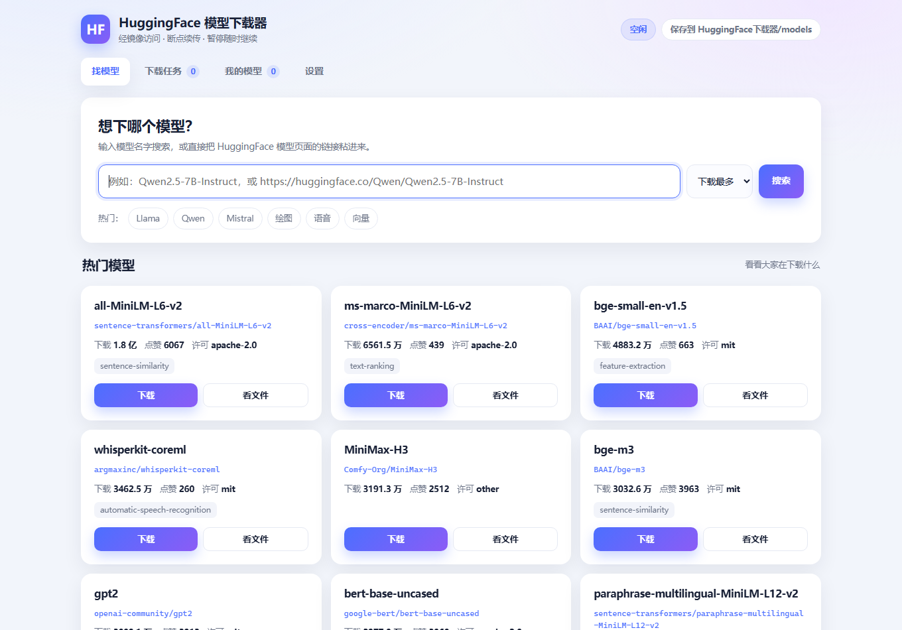

# HuggingFace 模型下载器

[](https://github.com/15072400099/huggingface-downloader/actions/workflows/ci.yml)

给不写代码的人用的 **HuggingFace 模型下载器**：双击即用，不用敲命令。

国内直连 `huggingface.co` 一般不通，这个工具默认走 **hf-mirror.com** 镜像，
搜索、看文件、下载、断点续传都在一个网页界面里完成。



## 特点

- **零第三方依赖**：只用 Python 标准库，传输层用 Windows 自带的 `curl.exe`，不用 `pip install` 任何东西
- **断点续传**：断网、关程序、手滑暂停，下次点「继续」接着下，不用重来
- **镜像可换、代理可选**：服务地址和代理都能在设置里改，默认**不走代理**（镜像是免费的，代理是花钱买速度）
- **看得清**：实时速度、剩余时间、已下/总大小，还能只挑自己需要的文件格式
- **不用登录**：公开模型直接下（gated 模型暂不支持）

## 快速开始

### 方式一：免安装 exe

从 [Releases](../../releases) 下载 `HFModelDownloader.exe`，放到任意文件夹双击即可。
模型存在 exe 旁边的 `models` 目录。

### 方式二：源码运行（Windows + Python 3.10+）

```bat
启动下载器.bat
```

没有第三方依赖，双击就能跑（前提是 PATH 里有 `python`）。
首次运行浏览器会自动打开 <http://127.0.0.1:8766>。

> 黑窗口就是程序本体，关掉它就停了。用完双击 `关闭下载器.bat` 更干净。

### 三个批处理

| 文件 | 作用 |
|---|---|
| `启动下载器.bat` | 启动（重复双击不会多开） |
| `关闭下载器.bat` | 停服务、清残留进程、关掉多余窗口 |
| `检查并补齐模型.bat` | 和远端清单逐个核对，缺的分片自动补 |

## 功能

| 页面 | 能干什么 |
|---|---|
| 找模型 | 关键词搜索、粘贴模型页链接、直输 `作者/模型名`；首屏展示热门模型 |
| 下载 | 选分支、勾选文件、一键「只要 safetensors / 只要 gguf」 |
| 任务 | 进度条、速度、剩余时间；暂停 / 继续 / 取消 / 重试 / 打开文件夹 |
| 我的模型 | 已下载清单、真实磁盘占用、完整路径、复制路径、删除 |
| 设置 | 保存位置、镜像地址、代理、并发数 |

## 为什么用 curl 而不是 requests

实测环境里，Python 的 TLS 握手会被对端重置，而同样的地址用 curl 就正常：

| 目标 | Python requests | curl |
|---|---|---|
| baidu.com | 成功 | 成功 |
| modelscope.cn | 成功 | 成功 |
| **hf-mirror.com** | **0/5 失败** | **5/5 成功** |
| **pypi.org** | **0/5 失败** | **5/5 成功** |

这是 TLS 指纹层面的差异，换证书校验、走代理、降 TLS 版本都绕不开，
所以传输层直接改用 `curl.exe`（Windows 10 1803 之后系统内置）。

代价是系统自带的 curl 8.4 不带 zlib 编译，`--compressed` 不可用，用普通的即可。

## 为什么不用 huggingface_hub

本项目只需要 HTTP Range：暂停＝中断进程并保留 `.incomplete`，继续＝从半截长度接着请求。
自己实现反而更可控，也不用跟着 `huggingface_hub` 的内部接口变化走。

## 速度与限制

- **速度慢**：实测 0.4~1.7 MB/s，随网络波动；多连接并行几乎没有提升（对端按 IP 限速）。
  下 15 GB 的模型大约 3~4.5 小时，请有心理准备。
- **仅 Windows**：用了 `os.startfile`、`.bat` 启动、系统 curl、Windows 路径处理
- **不支持登录**：gated / 私有模型下不了
- **只支持模型**，数据集未适配
- **非官方项目**：与 HuggingFace 无关，也不属于 hf-mirror.com

## 故障排查

| 现象 | 原因 | 怎么办 |
|---|---|---|
| 提示「TLS 握手失败」/ 连不上 | 镜像被拦截或临时故障 | 设置里点「测试连接」，换服务地址或填代理 |
| 搜索很慢或超时 | 镜像拥塞 | 稍后重试，或换服务地址 |
| 下载速度只有几百 KB/s | 对端限速 | 属正常现象，见上文 |
| 任务卡在某个百分比 | 单个连接停滞 | 暂停再继续，会重新建连 |
| 提示 401 / 403 | gated 或私有模型 | 本工具不支持登录下载 |
| 下载完少文件 | 分片中途失败 | 双击 `检查并补齐模型.bat` |
| 浏览器打不开 8766 | 服务没起来 | 看黑窗口里的地址；端口占用会自动顺延 |

日志在 `data/logs/server.log`。

## 安全说明

- 服务**只监听 `127.0.0.1`**，外部访问不到。请不要改成 `0.0.0.0`——
  本程序没有鉴权，且带有删除文件夹的接口
- 删除只能作用于下载目录内部，路径会做前缀校验
- 不读取、不上传任何账号信息；没有登录功能，也不写注册表

## 相关项目

同一位作者（AI agent）的三个同类工具，同一个界面骨架、同样零依赖（本项目是其中之一）：

| 项目 | 用途 | 备注 |
|---|---|---|
| [modelscope-download-manager](https://github.com/15072400099/modelscope-download-manager) | 下载魔搭（ModelScope）模型 |  |
| [huggingface-downloader](https://github.com/15072400099/huggingface-downloader) | 下载 HuggingFace 模型（走 hf-mirror 镜像） | **本项目** |
| [github-downloader](https://github.com/15072400099/github-downloader) | 下载 GitHub 的 Release 资源 |  |

## 反馈与建议

这个项目由作者个人维护，**不接收代码修改**（Pull Request 不会被合并）。

- 遇到问题、想提建议：开一个 [Issue](../../issues/new/choose)
- 想自己改着用：MIT 允许你 fork 任意修改，但不会合并回本仓库
- 版本变更：[CHANGELOG.md](CHANGELOG.md)
- 自己跑起来改：[CONTRIBUTING.md](CONTRIBUTING.md)

## 关于作者

- 代码：**AI agent 编写**，署名 `DEEPSEEK-V4.1-Flash 1017`
- 人类：**USER 一行代码未敲**，只负责提需求和验收

## License

MIT，见 [LICENSE](LICENSE)。
